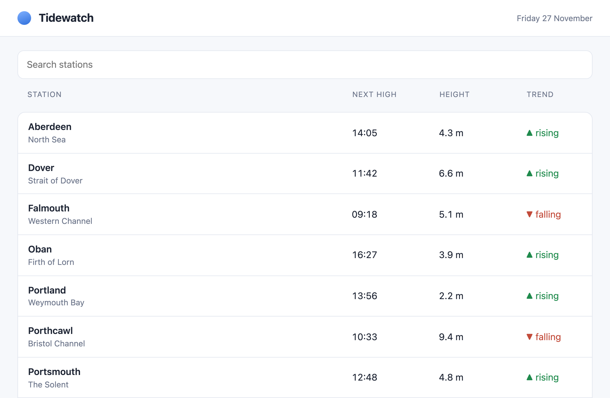

# filmstrip

Demo animations of software, made by a script. A capture script drives your app to each screen.
filmstrip turns those screens into a looping, lossless animated WebP, adding a pointer that clicks,
spotlights, zooms, key captions and fades.



The app is invented. [`examples/tides/capture.py`](examples/tides/capture.py) is the whole script
behind this animation.

## Why a script

- **Re-recordable.** After a UI change, one command records it again, and the same script gives the
  same pixels.
- **Nothing private on screen.** The data is invented and the clock is fixed.
- **Sharp.** Screens are captured at 4x, so a zoom crops real pixels instead of enlarging them.
- **Small and exact.** Lossless WebP keeps every pixel: about 1.3 MB for this 13-second demo at 2x.

## Install

```sh
pip install "filmstrip[web] @ git+https://github.com/0xDEADBEE7/filmstrip"
python -m playwright install chromium-headless-shell
```

## Use

```python
from filmstrip.web import Recorder

with Recorder("capture", "http://localhost:5173/", now="2026-03-02T09:30:00") as rec:
    rec.shot(hold=1300)
    rec.click("text=Settings", hold=1200, via="dip")
    rec.spotlight("#plan", hold=1400)
    rec.zoom("#usage", hold=1800, part=(0, 0, 0.5, 1))
    rec.press("Escape", hold=1000, caption="Esc")
```

```sh
filmstrip capture/manifest.json -o demo.webp --sheet sheet.png
```

`--sheet` draws every frame as a numbered thumbnail with its duration, so you can check a film at a
glance.

filmstrip isn't only for the web. Any program that saves screenshots can write the manifest, a
short JSON list of screens, holds and effects. For example, the
[DIE](https://github.com/0xDEADBEE7/die) editor draws its own screens for its extensions' READMEs.
The format, and what makes a good demo, are in [SKILL.md](SKILL.md).

## With Claude Code

[SKILL.md](SKILL.md) is a Claude Code skill. Clone this repository into `~/.claude/skills/filmstrip`;
the skill installs itself into a venv the first time it's used. Claude will then make demos when you
ask for one, following the skill's advice on timing, effects and invented data.

## Development

```sh
python3 -m venv .venv && .venv/bin/pip install -e ".[web,test]"
.venv/bin/python -m playwright install chromium-headless-shell
.venv/bin/python -m pytest
```

`examples/tides` doubles as the end-to-end test. To redraw this README's animation:

```sh
.venv/bin/python examples/tides/capture.py capture/tides
.venv/bin/filmstrip capture/tides/manifest.json -o docs/tides.webp
```

## Licence

MIT or Apache-2.0, at your option: [LICENSE-MIT](LICENSE-MIT), [LICENSE-APACHE](LICENSE-APACHE).
